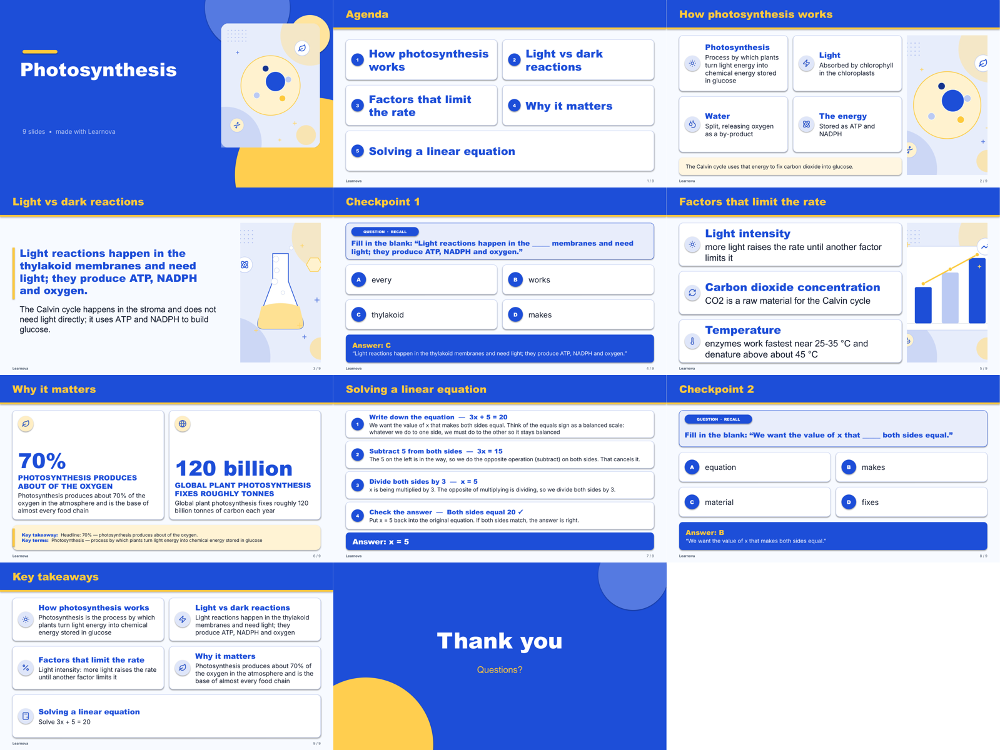
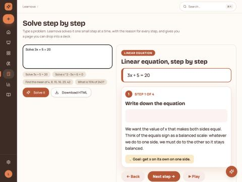
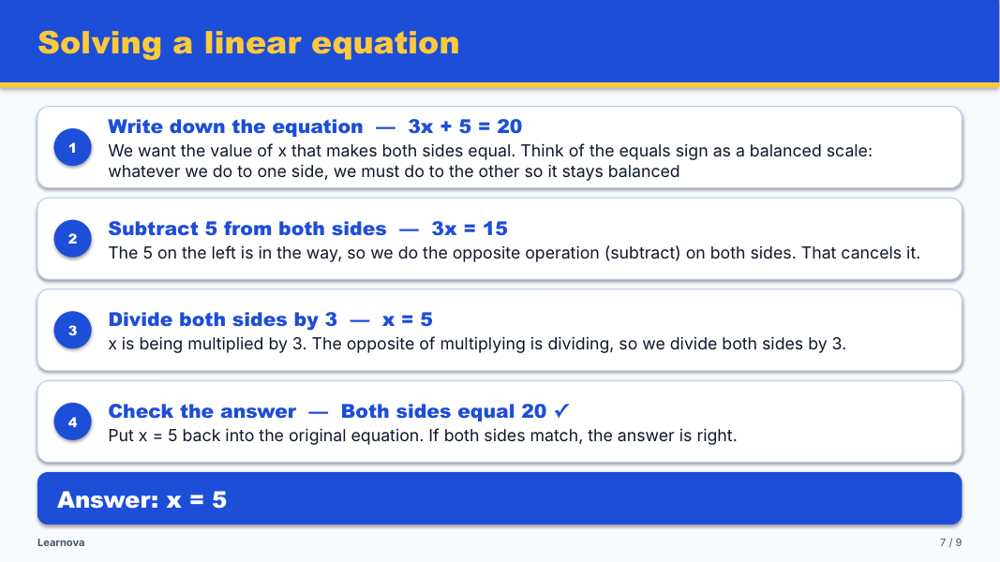
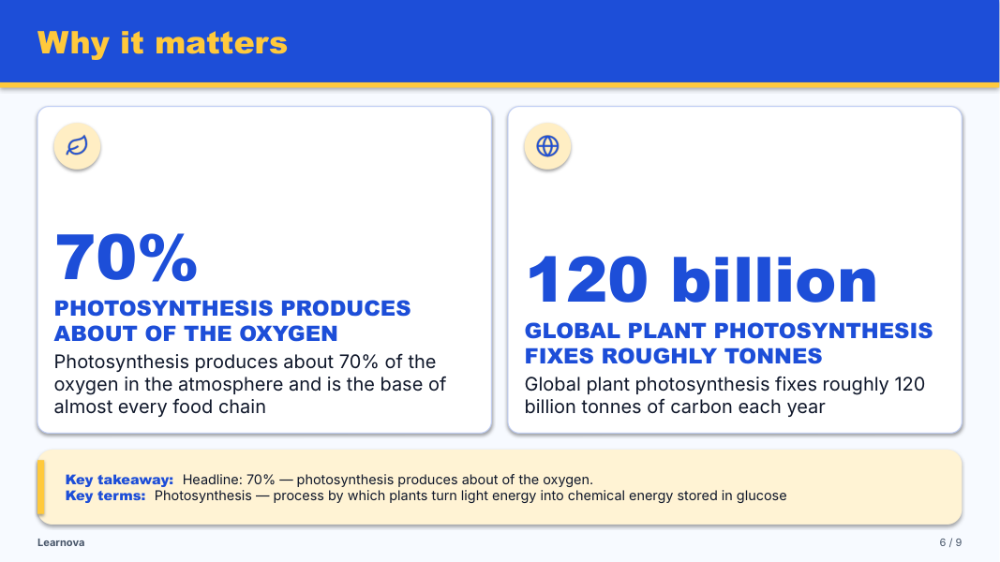
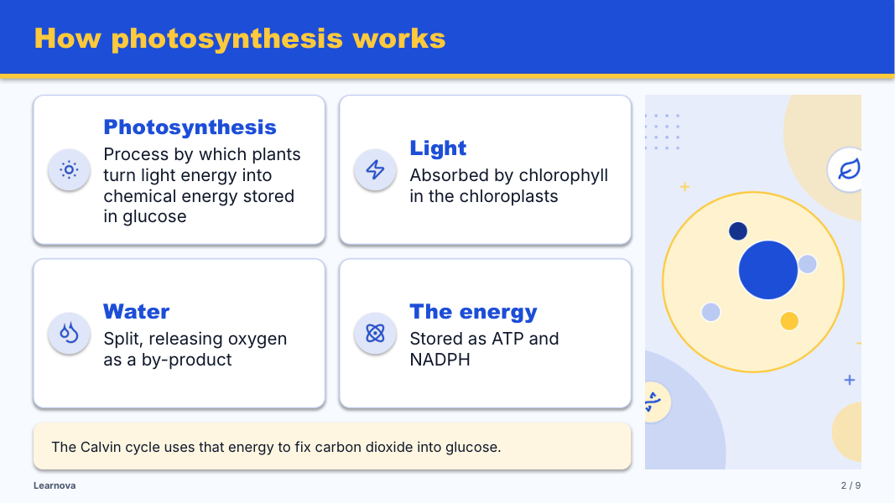
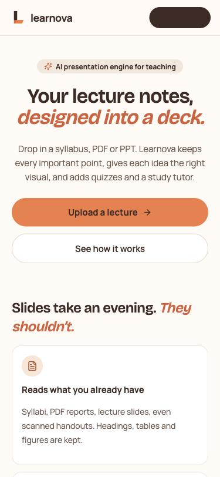
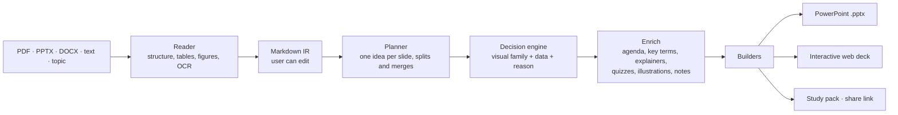

<div align="center">


# Learnova

**Turn lecture notes, PDFs and old slide decks into designed, interactive presentations — with visuals chosen for each idea, step-by-step problem explainers, quizzes and a study tutor.**




<sub>A full deck generated from five short paragraphs — no API key used.</sub>

</div>

---

## Contents

- [Why Learnova](#why-learnova)
- [Screenshots](#screenshots)
- [Features](#features)
- [How it works](#how-it-works)
- [Quick start](#quick-start)
- [Configuration](#configuration)
- [Use it on a phone (installable app)](#use-it-on-a-phone-installable-app)
- [API overview](#api-overview)
- [Project structure](#project-structure)
- [Testing and quality checks](#testing-and-quality-checks)
- [Deployment](#deployment)
- [Roadmap](#roadmap)

---

## Why Learnova

Most lecture slides are walls of bullet points. Re-designing them takes an evening per lecture, and generic AI tools
invent content or lose what the teacher wrote. Learnova keeps **every important point from the source** and changes how
it is shown:

| Before | After |
|---|---|
| Bullet lists | A process becomes a **flow**, a comparison a **table**, a number a **stat tile**, a definition a **callout** |
| A worked example as text | An **interactive stepper** that solves it one step at a time, with the reason for each step |
| No checks for understanding | **Checkpoint quizzes**, flip cards, a click-to-match activity and a deck **tutor** |
| One static file | **PowerPoint (.pptx)** + an **interactive web deck** + a **study pack** + a **share link** |

It runs fully **without API keys** (every decision is rule-based and every number is computed). It is **offline first**:
free Gemini, Groq or NVIDIA keys are used only where the rule-based result is weak — a picture whose OCR is unreadable, a
title that is only a topic label, a slide whose idea needs a real drawing, a problem no exact solver knows — and every AI
output is checked before it reaches a slide. When every free quota is used up, the deck still finishes.

---

## Screenshots

<table>
<tr>
<td width="50%"><br /><sub><b>Deck preview</b> — every slide, the visual chosen and why, timing and transitions.</sub></td>
<td width="50%"><br /><sub><b>Solve step by step</b> — type a problem, get a beginner-level walkthrough to drop into any deck.</sub></td>
</tr>
<tr>
<td><br /><sub><b>Solution slide</b> — numbered steps with the working and the reason, then the answer.</sub></td>
<td><br /><sub><b>Facts become stat tiles</b> with their labels taken from the source sentence.</sub></td>
</tr>
<tr>
<td><br /><sub><b>NLP explainers</b> — Viterbi, Naive Bayes, bigram probability and CYK parsing, computed exactly.</sub></td>
<td><br /><sub><b>Illustrations drawn from the slide's content</b>, in the deck's colours.</sub></td>
</tr>
</table>

<p align="center">
  
  &nbsp;&nbsp;
  
  <br /><sub>Responsive on phones, and installable as an app.</sub>
</p>

---

## Features

### Turning sources into decks
- **Inputs:** PDF reports, **lecture-slide PDFs** (page-by-page, bullet nesting, tables, figures, OCR for picture slides), PPTX, DOCX, Markdown, plain text, or a one-line topic.
- **Colour DNA:** a source deck's own colours become the new deck's theme.
- **Content decision engine** (`src/learnova/visuals/engine.py`): reads each slide and picks one of 30 visual families — process, cycle, **flowchart**, **algorithm**, **equations**, timeline, comparison table, pros/cons, matrix, funnel, stat tiles, charts, definition and formula callouts, outline cards, figure slides and more — and builds the data to draw it. Every choice comes with a reason.
- **Each kind of content gets its own box:** a procedure that branches or loops becomes a **flowchart** (start/end, process boxes, decision diamonds, Yes/No branches, loop-backs); pseudocode becomes one numbered **algorithm** panel with its indentation (recovered when the export lost it); a run of equations becomes one **equations** panel; XML/code examples are shown verbatim.
- **Equations as real maths:** linear text such as `J(w,b) = (1/2m) Σ_(i=1)^m (h(x_i) - y_i)^2` is parsed and written as a native, editable **PowerPoint equation** (as in Word) and as MathML in the web deck, with a clean Unicode fallback (`src/learnova/visuals/mathfmt.py`).
- **Faithful to real decks:** text read from pictures never becomes bullet points, a teacher's build-up slides are merged into the complete one, OCR captions appear only when readable, and Word files are read natively.
- **Nothing is lost:** text a visual cannot carry goes to an **“In plain words”** panel in the slide body (11–14 pt, never a tiny footer) or the speaker notes; a fact-retention check reports figures, dates, formulae and terms kept per slide.
- **Readable layout:** text is fitted glyph-by-glyph so a word is never broken across lines; type sizes are capped rather than inflated to fill space; thin continuation slides are merged.
- **Titles:** sentence case, no stray bullets or repeated words, and generic titles ("Introduction", "Overview") replaced by the slide's own claim.

### Interactive teaching
- **Step-by-step explainers** (`src/learnova/explain/`): linear and quadratic equations, systems, percentages, interest, statistics, probability, Bayes' rule, derivatives, integrals, geometry, **CYK parsing, bigram probability, Naive Bayes and Viterbi**. Every number is computed with SymPy or exact fractions. With a key, an AI fallback handles anything else and is clearly labelled.
- **Illustrations chosen per slide:** each slide is classified (flow, plot, anatomy, comparison, scene, or none) and a detailed SVG figure with numbered, titled parts is drawn for it — the linked page steps through the parts and highlights them on hover. Offline scenes cover the rest; diagrams are sanitised and rendered with resvg.
- **Web deck:** one standalone HTML file with click-by-click reveals, flip cards, click-to-match, figure zoom, the original slide on demand, and the full explainer in an overlay.
- **Interactive labs:** step-by-step simulations a student can play with. Built in: **Region Growing, CYK parsing, Viterbi/HMM, bigram model, Naive Bayes WSD and HMM POS tagging**. For any other topic a lab is **generated while the deck is built** — written by the AI model for that exact topic when a key is set (code-checked before use), otherwise built from the slide's own steps, comparisons or ideas. Labs open over the slide in the web deck and from a clickable button in the PowerPoint; teachers can add their own (`POST /api/labs`).
- **Checkpoint quizzes every four slides** (at most 20 per deck) from the deck's own definitions, tables, steps and figures, with distractors of the same word type.
- **Discussion questions** tied to each slide's topic, shown on every third content slide between the quizzes and in the speaker notes elsewhere.
- **Click-by-click builds in PowerPoint** (segmenting): each part of a slide appears on click in teaching order, at most eight steps per slide, plus slide transitions.
- **Tutor** grounded in the deck, with selectable personas.

### Presenting and sharing
- Editable **PowerPoint** with native shapes, tables, charts and speaker notes.
- **Presenter console** with notes, timer, next-slide preview and a synced audience window.
- **Before vs after** analysis per slide.
- **View-only share links** (expire, can be turned off), and a **study pack**: flashcards (CSV / Anki), quiz bank (CSV / JSON), a one-page cheat sheet and a narration script.

### Product
- Phone + OTP sign-in, per-user deck library, versions, restart-safe background jobs with cancel.
- **AI keys** can be added from Settings; nothing is required to start.
- Responsive web app and **installable PWA**.

---

## How it works



Everything under `src/learnova/` is UI-agnostic; the FastAPI app and the React frontend call the same pipeline
(`learnova.pipeline.orchestrator`). A detailed module-by-module guide lives in
[`docs/DEVELOPER_GUIDE.md`](docs/DEVELOPER_GUIDE.md).

---

## Quick start

**Requirements:** Python 3.12, Node 20+, and optionally LibreOffice (slide thumbnails) and Tesseract (OCR for picture-only slides).

```bash
git clone https://github.com/SDP42/LearnovaV2.git
cd LearnovaV2
pip install -r requirements.txt
cp .env.example .env            # keys are optional
(cd frontend && npm install)
```

Run the API and the web app (two terminals):

```bash
python -m uvicorn apps.api.main:app --port 8000
```

```bash
cd frontend && npm run dev -- --port 5190
```

Open <http://localhost:5190>, sign in with any mobile number (in dev mode the code is shown on screen), then
**Create** → paste notes or upload a PDF → **Generate** → **Preview**, **Present** or **Export**.

Build a deck from the command line without the app:

```bash
python scripts/render_preview.py demo/corpus/bio_cycle.md
```

---

## Configuration

All settings live in `.env` (see `.env.example`). None are required.

| Variable | What it enables |
|---|---|
| `GEMINI_API_KEY`, `GEMINI_API_KEYS` | One key, or a comma-separated pool of free keys (paced 4.2 s apart each, a spent key is skipped for 15 min): diagrams, titles, vision |
| `GROQ_API_KEY`, `GROQ_API_KEYS` | Fast AI rewriting and quizzes; a pool rotates when one key reaches its daily limit (keys of one account share that account's limit) |
| `LEARNOVA_AI_MODE` | `auto` (default: AI only where the offline result is weak), `always`, or `off` |
| `LEARNOVA_LLM_EXPLAINERS` | Most AI-written explainers per deck for problems no solver knows (default 6) |
| `LEARNOVA_PPTX_ANIM` | `0` turns click-build animations off |
| `NVIDIA_API_KEY` | Higher-quality rewriting, automatic fallback |
| `OTP_DEV_MODE` | `1` shows sign-in codes on screen (default for local use) |
| `OTP_SMS_PROVIDER` | SMS provider for real one-time codes in production |

Keys can also be added at runtime from **Settings → AI keys**; they are stored on the server and never shown again.

---

## Use it on a phone (installable app)

Learnova is a **Progressive Web App**:

- The landing page has a layout written for phones; the app uses a bottom tab bar under 768 px and never scrolls sideways.
- Open the site on a phone and choose **Add to Home Screen** (iOS) or **Install app** (Android / desktop Chrome). It opens full-screen with its own icon and shortcuts (*New deck*, *My decks*, *Solve step by step*).
- The app shell is cached by a service worker, so it opens offline; generating decks needs the server.

Packaging as a store app later (Capacitor or a Trusted Web Activity) can reuse the same build.

---

## API overview

| Endpoint | Purpose |
|---|---|
| `POST /api/jobs` · `POST /api/jobs/typed` | Upload a file or send text; returns a job |
| `POST /api/jobs/{id}/generate` · `GET /api/jobs/{id}` | Build the deck, poll progress, cancel |
| `GET /api/decks/{id}/download/{pptx\|html}` | Download PowerPoint or the web deck |
| `GET /api/decks/{id}/analysis` | Before-vs-after analysis |
| `POST /api/explain` | Solve a typed problem step by step (JSON + HTML) |
| `GET /api/decks/{id}/explainers[/{slide}]` | Solved problems in a deck, as standalone HTML |
| `POST /api/decks/{id}/shares` · `GET /api/share/{token}` | Create and open view-only links |
| `GET /api/decks/{id}/export/{kind}` | Study pack: flashcards, quiz bank, cheat sheet, script |
| `GET/POST/DELETE /api/providers` | Manage AI keys |
| `GET /api/health` | Health, queue and dependency status |

Interactive docs: <http://localhost:8000/docs>.

---

## Project structure

```text
LearnovaV2/
├── apps/api/main.py            FastAPI app: auth, jobs, decks, explainers, shares, exports, providers
├── src/learnova/
│   ├── parsers/                PDF, slide-PDF (OCR, tables, figures), PPTX, DOCX, Markdown IR
│   ├── pipeline/               orchestrator, planner, density, enrich, polish, jobs
│   ├── visuals/engine.py       content decision engine
│   ├── rendering/              PPTX builder, web deck builder, layout fitting, themes, templates
│   ├── explain/                step-by-step solvers, detection, stepper page, AI fallback
│   ├── ai/                     quizzes, illustrations (scenes), image providers, tutor
│   ├── analysis/               before/after, accessibility, source colour DNA
│   ├── evaluation/             layout audit (overflow, sparse slides, broken words)
│   └── storage/                deck library, share links
├── frontend/                   React + Vite app, landing page, PWA manifest and service worker
├── tests/                      pytest suite (736 tests)
├── scripts/                    render_preview, contact_sheet, e2e_check, deck_report
├── demo/corpus/                sample lessons used for regression checks
└── docs/                       developer guide, research notes, images
```

---

## Testing and quality checks

```bash
python -m pytest -q                                  # unit + integration tests
python scripts/e2e_check.py                          # drives every API route in-process
E2E_PDF=path/to/lecture.pdf python scripts/e2e_check.py pdf
python -m learnova.evaluation.layout_audit deck.pptx # overflow, sparse slides, broken words
python scripts/contact_sheet.py deck.pdf sheet.png 1 5 9   # review pages side by side
```

Visual-selection accuracy is gated by gold sets in `tests/fixtures/` so a change that picks worse visuals fails CI.

---

## Deployment

One Docker container runs the API, the built web app, LibreOffice and Tesseract (`Dockerfile`). Free options, compared in
[`docs/DEPLOY.md`](docs/DEPLOY.md): **Hugging Face Spaces** (Docker, 16 GB RAM — runs everything), **Render** (`render.yaml`,
small decks), or the web app on **Vercel** (`frontend/vercel.json`) with the API on Spaces or Render.

```bash
docker build -t learnova . && docker run -p 8000:8000 --env-file .env learnova     # then open http://localhost:8000
```

---

## Research

Two papers describe the methods: an IEEE paper (slide reader, decision engine, PSF metric, CLASS segmentation, layout,
algorithm/equation panels) and a Springer LNCS paper (computed explainers, checked labs, sanitised diagrams, grounding filter,
paced key pool, offline-first escalation). Sources and measurement scripts are in `docs/research/` and `scripts/research/`.

---

## Roadmap

- Classroom study with our own students; calibrate the PSF weights with their ratings
- Hindi and Marathi decks; voice narration
- More explainers (dependency parsing, TF-IDF, edit distance) and flowcharts for nested decisions
- LMS export (Moodle, Google Classroom); store packaging (Capacitor) on top of the PWA

---

<div align="center"><sub>Built by Swayam Devendra Panchal, Kawaljeet Singh Bharaj, Jeevesh Bharat Bodhani and Rishit Pankajkumar Lahoti,
guided by Dr. Pratik Kanani (Head of Department, AI &amp; DS, DJSCE) · Learnova V2</sub></div>
