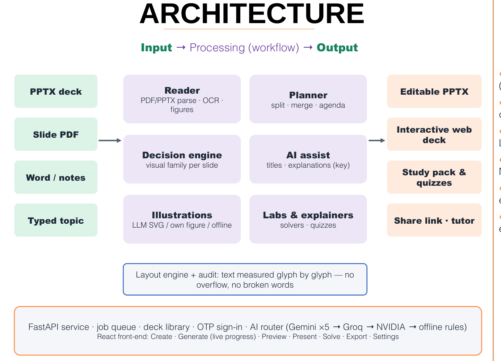
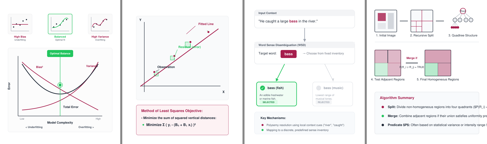

# System Design

## Architecture Overview

Learnova follows a layered architecture in which the user interface, the web service, the processing pipeline, the AI services and the storage are separate and replaceable. Figure 1 shows the system as a flow from inputs to outputs. Each layer communicates with the next through a narrow interface: the front end talks only to the REST API, the API starts and monitors jobs, the pipeline converts every input into one intermediate representation, and the builders turn the final slide plan into files.

{width=72%}

The five columns of the architecture are:

1. **Inputs** — a PowerPoint file, a slide PDF, a Word document or notes, a typed topic, and laboratories uploaded by teachers.
2. **Ingestion** — conversion of PowerPoint files to PDF with LibreOffice, the page-by-page slide reader, the OCR decision for picture-only slides, repair rules for page furniture and glued titles, and extraction of the source colour palette.
3. **Engines** — the planner with the CLASS segmentation algorithm, the Content Decision Engine, the layout engine, the exact explainer solvers, and the PSF scorer and audit.
4. **AI service** — the router across Gemini, Groq and NVIDIA providers, AI polishing of titles and explanations, AI-written topic diagrams, AI-written laboratories, and the offline fallbacks.
5. **Outputs** — the editable PowerPoint file, the web deck, the study pack, share links and the presenter console, and the deck tutor.

## Data Flow

A generation request passes through the following stages, each reported to the user with live progress:

1. **Convert.** The uploaded file is converted into Markdown with one section per slide and a metadata record per page (figure, preview image, OCR text, palette). For PowerPoint files, LibreOffice renders a PDF first; the result is cached by a hash of the file so that a repeated upload is instant.
2. **Review.** The user may inspect the extracted outline before generation.
3. **Plan.** Overloaded slides are split with CLASS, very short consecutive parts of one topic are merged, and an agenda, key takeaways, a glossary and checkpoint questions are added.
4. **Polish.** Titles are cleaned and, with a key, rewritten as assertions; thin slides receive a plain explanation and an example.
5. **Decide.** The decision engine chooses a visual family and builds its data.
6. **Illustrate.** Every topic slide receives a picture; diagrams are generated in parallel.
7. **Labs.** Laboratories are matched or generated for suitable topics.
8. **Build.** The PowerPoint and web builders write the files; scores and analysis are computed.
9. **Store.** The deck, its versions and its artefacts are saved in the user's library.

## Module Design

### Input parsers

Separate parsers handle each format. The slide-PDF reader (Section 5.1) is the most important, since PowerPoint files are also routed through it. The Word parser keeps headings, lists and tables. Typed topics are expanded into an outline by the language model when a key is present, or used as a single section otherwise.

### Content Decision Engine

The engine contains 27 detectors, each responsible for recognising one kind of structure — a process, a cycle, a timeline, a comparison, a definition, a formula, a statistic, a hierarchy, a set relation and others. Each detector returns a family, a confidence, the data needed to draw the visual and a reason. The engine also produces card headings and takeaways. It is described in Section 5.2.

### Deck director and builders

The deck director turns the decisions into a slide plan, adds speaker notes, timing estimates and transitions, and ensures that consecutive slides do not repeat the same layout too often. The PowerPoint builder draws every visual with native shapes so that teachers can edit them; the web builder produces a single HTML file using Reveal.js, with click-by-click reveals, flip cards, a matching activity, zoomable figures and an original-slide viewer.

### Illustration subsystem

The illustration subsystem chooses the picture for each slide (Section 5.6), generates diagrams with the key pool, validates them, caches them and publishes them at `/api/art/{id}`.

### Explainers and laboratories

The explainer subsystem detects solvable problems in slide text and produces step-by-step solutions (Section 5.7). The laboratory subsystem holds built-in laboratories, matches them to slide topics, generates new laboratories and serves them at `/api/labs/{id}` (Section 5.8).

### Platform services

The platform provides authentication with one-time passwords, a job queue that survives restarts, a deck library with versions, share links, the study-pack exporter, the presenter console and the deck tutor.

## Database Design

The system stores its records in SQLite and its artefacts on disk. The main tables are listed below.

Table: Main database tables.

| Table | Key fields | Purpose |
|---|---|---|
| users | id, phone, created_at | One row per signed-in user |
| otp_codes | phone, code_hash, expires_at, attempts | Hashed one-time passwords with expiry and attempt limits |
| sessions | token_hash, user_id, expires_at | Sign-in sessions |
| jobs | id, user_id, status, stage, progress, error | Generation jobs, restart-safe |
| decks | id, user_id, title, version, slide_count, scores | Saved decks with their latest version |
| deck_versions | deck_id, version, note, created_at | Version history for edits and refreshes |
| shares | token, deck_id, user_id, revoked | View-only share links |

Artefacts (PowerPoint file, web deck, slide payload, images, editable slides) are stored per deck and version. Caches for converted documents, OCR results, language-model responses, diagrams and laboratories are keyed by content hashes.

## API Design

The web service exposes about seventy endpoints. The most important are grouped below.

Table: Main API endpoints.

| Group | Endpoints |
|---|---|
| Authentication | POST /api/auth/otp/request, POST /api/auth/otp/verify |
| Jobs | POST /api/jobs, POST /api/jobs/{id}/generate, GET /api/jobs/{id}, GET /api/jobs/{id}/download/{artifact} |
| Library | GET /api/decks, GET /api/decks/{id}/editable, PUT /api/decks/{id}/slides, POST /api/decks/{id}/refresh |
| Sharing | POST /api/decks/{id}/shares, GET /api/share/{token} |
| Learning | POST /api/explain, GET /api/labs, GET /api/labs/{id}, GET /api/art/{id}, POST /api/decks/{id}/chat |
| Settings | provider key management and status endpoints |

## User Interface Design

The front end is a single-page application with a warm, bright visual style. Its main pages are **Create** (upload or type a topic), **Generate** (live progress of every stage), **Preview** (every slide with its visual, reason, timing and transition, and a full-size preview of the selected slide), **Present** (presenter console with notes, timer and an audience window), **Solve** (type a problem and get a step-by-step explanation), **Export** (downloads, study pack and share links), **Quizzes**, **Gallery** (more than a thousand ready-made lesson decks), **Analytics** and **Settings**. On phones the layout switches to a dedicated mobile design with a bottom tab bar, and the application can be installed as a progressive web app.

{width=65%}

# Methodology and Algorithms

This chapter describes the methods we designed. Each is implemented as a separate module with its own tests.

## Recovering the Structure of a Slide Deck

A deck exported to PDF contains one slide per page, but its structure is implicit: bullets are separate glyphs, nesting is only an indent, tables may be pictures and diagrams are drawings. The reader works on text lines, each with a bounding box $(x_0, y_0, x_1, y_1)$, a font size $s$ and a font name.

**Page furniture.** Course names, author lines and slide numbers repeat on many pages. A line in the top 12% or bottom 14% of a page is treated as furniture when the same normalised text appears in that band on at least

$$m(n) = \max\left(3,\ \lfloor 0.3\,n \rfloor\right)$$

of the $n$ pages. Pictures that repeat on many pages (logos, backgrounds) are removed in the same way, but counted only on pages where they are actually drawn, because some exporters list every image of the deck in a shared resource dictionary.

**Titles.** With $\bar{s}$ the body font size (the size that carries the most characters), the largest line $\ell^{*}$ in the top third of a page of height $H$ is accepted as the title when

$$s(\ell^{*}) \ge 1.18\,\bar{s} \quad \text{or} \quad \big(\text{bold}(\ell^{*}) \text{ and } y_0(\ell^{*}) < 0.2H\big).$$

A following line continues a wrapped title when it has the same size, starts at the same horizontal position and its vertical gap $g$ satisfies $-0.5\,s < g < 0.9\,s$.

**Bullet levels.** The horizontal positions of bullet glyphs are clustered with a tolerance of 9 points into anchors $a_1 < a_2 < \dots < a_K$, and an item that starts at position $x$ receives the level $\ell(x) = \arg\min_k |x - a_k|$. Lines without a glyph are joined to the previous item when they continue an unfinished sentence.

**Glued titles.** Titles written in capitals sometimes lose their spaces ("CONSTRUCTINGTHETABLE"). Such a token $t$ is segmented by dynamic programming over a vocabulary $V$ built from the deck itself and a dictionary:

$$B(j) = \max_{i<j,\ t_{i:j} \in V}\big(B(i) + (j-i)^2\big), \qquad B(0)=0.$$

Squaring the length of each word favours a few long words over many short ones.

**Picture-only slides.** When the largest picture covers at least 45% of the page and the page has at most twelve words of text, the picture is read with Tesseract. Let $I$ be the set of dark pixels and $M$ the area covered by recognised words; the *graphic ratio*

$$\gamma = \frac{|I \setminus M|}{|I|}$$

is close to zero for a screenshot of text and large for a diagram. The recognised text replaces the picture only when the mean confidence is at least 62, there are at least twelve words, $\gamma \le 0.42$ and at most 15% of the lines are symbol debris; otherwise the picture is kept as a figure. This rule matters most for equations: a derivation read by OCR as random symbols is worse than the picture of the derivation.

**Charts and continuation sentences.** When most "bullets" of a slide are numbers of fewer than four words, they are the axis ticks of a drawn chart; the chart region is rendered as an image instead. A bullet that begins with "means", "is" or "refers to" is joined to the label before it, so "Low variance:" followed by "means that the model…" becomes one complete sentence.

## Content Decision Engine

For each slide, the 27 detectors are run. A detector returns either nothing or a tuple $(f, v, c, D, r)$: the visual family $f$, a variant $v$, a confidence $c \in [0,1]$, the data $D$ the renderer needs and a reason $r$ in plain words. Tables, section outlines and reference lists are tested first. The remaining candidates are filtered by exclusion rules learned from the gold set — for example, a cycle removes a linear process and a definition removes statistic tiles — and the decision is

$$d^{*} = \arg\max_{d \in X(\mathcal{C})} c_d .$$

The three next-best candidates are kept as alternatives for the slide editor. If no detector fires, the slide is shown as key-point cards that carry every sentence in full, so a visual choice never removes text. Card headings are formed from the sentence itself: discourse cues and pronouns are removed, the first three content words are kept, the heading is cut at an unbalanced parenthesis, and trailing function words, modal verbs and adverbs are removed so that a heading never ends in the middle of a phrase.

## Pedagogical Slide Fitness (PSF)

PSF is a metric we designed to estimate how suitable a slide is for learning. It combines three components, each between 0 and 1.

**Information efficiency** rewards a slide for introducing new concepts without repeating itself. With $\mathcal{N}(s)$ the concepts on slide $s$ that did not appear on earlier slides, a rarity weight $\text{idf}(w)$ between 0.4 and 3.0 that grows with word length, and the redundancy $\rho(s)$ measured as the mean overlap of each bullet with the title or the other bullets,

$$U(s) = \sum_{w \in \mathcal{N}(s)} \text{idf}(w), \qquad E(s) = \frac{U(s)}{U(s) + \kappa_e}\,\big(1 - \rho(s)\big).$$

**Cognitive load** estimates how much working memory the slide demands. With $k$ distinct concepts, relational-cue density $r$, word count $t$, the largest number of visual elements $v$ and a split-attention indicator $\sigma$,

$$L(s) = \text{sigmoid}\big(w_e \hat{e} + w_t \hat{t} + w_v \hat{v} + w_\sigma \sigma - \theta\big),$$

where $\hat{e} = \min(1, k(1+r)/e_{\text{ref}})$, $\hat{t} = \min(1, t/t_{\text{ref}})$ and $\hat{v} = \min(1, v/v_{\text{ref}})$.

**Multimedia coherence** $C(s)$ is the mean of four indicators taken from Mayer's principles: signalling (a real title and a takeaway), coherence (the share of sentences on the slide's topic), non-redundancy (a picture's description does not repeat the text) and spatial contiguity (the figure is on the same slide as its explanation).

The slide score is the weighted geometric product

$$\text{PSF}(s) = E(s)^{\alpha}\,\big(1 - L(s)\big)^{\beta}\,C(s)^{\gamma}, \qquad \alpha + \beta + \gamma = 1,$$

so that a very high load cannot be compensated by more information. For a deck, the geometric mean of the slide scores is multiplied by a flow term that rewards a moderate overlap of concepts between consecutive slides. The default parameters are listed below.

Table: PSF and CLASS parameters.

| Parameter | Meaning | Value |
|---|---|---|
| $\alpha, \beta, \gamma$ | weights of $E$, $1-L$ and $C$ | 0.40, 0.42, 0.18 |
| $\kappa_e$ | half-saturation of new information | 6 |
| $w_e, w_t, w_v, w_\sigma$ | load weights | 1.10, 1.35, 0.85, 1.60 |
| $\theta$ | load bias | 2.30 |
| $e_{\text{ref}}, t_{\text{ref}}, v_{\text{ref}}$ | load references | 9, 16, 8 |
| $\lambda$ | cost of one more slide | 0.35 |
| $\mu$ | weight of missing information | 0.9 |
| $\nu$ | overflow penalty | 0.25 |

## CLASS: Load-Optimal Slide Segmentation

When a slide has too many points, it must be split into several slides. A naive method splits the points evenly. CLASS (Cognitive-Load-Aware Slide Segmentation) instead chooses the split that minimises the total cognitive cost. Given points $b_1, \dots, b_m$, a maximum of $P$ points per slide and a soft target $T$, CLASS chooses break points that minimise

$$J = \sum_{k=1}^{K} \Big[ L(G_k) + \mu\big(1 - E(G_k)\big) + \nu \max\big(0, |G_k| - T\big)^2 \Big] + \lambda K,$$

where $G_k$ is the $k$-th group of consecutive points. Because the cost of a group depends only on its own points, the optimum is found by the recurrence

$$F(i) = \min_{\max(0, i-P) \le p < i} \big[ F(p) + \text{cost}(b_{p+1..i}) + \lambda \big], \qquad F(0) = 0,$$

in $O(mP)$ time. Every point is placed exactly once, so segmentation never loses content.

## Layout Without Broken Words

The most visible defect of automatically generated slides is a word split across two lines. Learnova prevents it with two width models. For counting lines, a box $W$ inches wide holds about $\lfloor 72W / (\bar{\rho}\,s) \rfloor$ characters per line at font size $s$, with $\bar{\rho} = 0.52$ for regular and $0.575$ for bold text. For single words, the width is measured character by character from the font metrics:

$$w(u, s) = \kappa\,\frac{s}{72} \sum_{ch \in u} \rho(ch),$$

with a safety factor $\kappa = 1.06$. The font size of a box is the largest size on a half-point grid at which the text fits, never below 11 points for body text; content that still does not fit moves to a continuation slide. Finally every paragraph is scaled by

$$\sigma = \max\Big(0.62,\ \min\big(1,\ \min_u W / w(u, s)\big)\Big),$$

which guarantees that the longest word fits on one line. Wide visuals such as process flows, timelines and tables keep the full width of the slide.

## Illustrations with Two Fallbacks

Every topic slide receives a picture, chosen in this order: the source's own figure, shown beside the text; a diagram written by a language model; and a scene from the offline illustrator. For the AI diagram, the model receives the slide's title and text and is asked for one SVG figure that shows the mechanism of the idea, labelled with the slide's own terms, in the deck's colours. The answer is sanitised before use: scripts, embedded images, external links, filters and style sheets are removed, inline styles are converted into attributes, and the diagram must contain at least five shapes and render correctly. Labels that would run past the edge are scaled down using the width model of the previous section. Accepted diagrams are cached by a hash of the slide text, embedded in the web deck, rasterised for PowerPoint and published as an HTML page to which the PowerPoint picture links. Offline scenes are published and linked in the same way, so every picture in the PowerPoint opens its own page.

{width=68%}

**Key-pool scheduling.** The free tier of the Gemini API allows a limited number of requests per minute per key. Learnova uses a pool of keys: each key is paced separately with a minimum interval $\Delta = 4.2$ seconds, two requests are kept in flight per key, and a key that reports an exhausted quota or an invalid credential is skipped for fifteen minutes. With $|K|$ keys the sustained rate is $|K|/\Delta$ requests per second. When every key fails, the system continues with offline logic, so a deck is never blocked by an external service.

## Step-by-Step Explainers

When a slide contains a problem that the system can solve exactly, it produces an explainer: a sequence of steps, each with a short action title, the working with the changed part highlighted, a plain-language reason and the general rule behind it. Candidate problem statements are taken from the whole slide, from pairs of neighbouring equations, from each line and from each sentence; each candidate is offered to the solvers in a fixed order and the first accepted solution is used. An explainer is accepted only if it has at least three steps and every step has a reason. All arithmetic is exact, using symbolic algebra and fractions, so a number shown to a student is never guessed. With a key, a problem that no solver recognises may be explained by the language model; such an explanation is clearly labelled as not computed by the system.

## Interactive Laboratories

All laboratories share one page structure: preset examples, a view of the current state, an explanation panel with *Step*, *Back* and *Play* controls, and a form for the student's own input. A laboratory is defined by a function that turns an input into a list of frames, each frame being one small decision with its explanation. A slide receives a built-in laboratory when its title matches the laboratory's topics. Otherwise a laboratory may be generated under a policy that keeps decks usable: one laboratory per topic, the same laboratory at most twice per deck, at most ten generated laboratories per deck, and none for agenda, summary or quiz slides or for titles that look like OCR noise. With a key, the language model writes the laboratory's code, which must pass a syntax check and may not use network or storage functions; without a key, the laboratory is built from the slide's own structure — a process is walked step by step, a comparison is explored criterion by criterion, and concepts are revealed one at a time after a "think first" prompt.

## Grounded Language-Model Assistance

With a key, the system asks the language model for an assertion title, a short explanation for thin slides, an example and up to two key terms per slide, in batches of ten slides. Each answer is checked before use: a title must be a full sentence of four to fifteen words, must share at least one content word with the slide and must not begin with a command; an explanation must share at least two content words with the slide. Answers that fail are discarded and the rule-based version is kept.

## Checkpoint Quizzes

Quizzes are generated without a key from the decisions of the engine: definitions become "which term matches this description" questions, ordered processes become "what comes next" questions when their steps are clean, comparison tables become look-up questions, and statistics become "what was the figure for" questions. Distractors are drawn from the same deck and matched in form to the correct answer. Questions built from slide-part counters, symbol debris or example sentences are rejected.

