# Implementation

## Technology Stack

Table: Technology stack.

| Layer | Technologies | Role |
|---|---|---|
| Front end | React 18, Vite, Tailwind CSS | Single-page application, responsive and installable |
| Web deck | Reveal.js, inline SVG, vanilla JavaScript | Interactive presentation with reveals, overlays and labs |
| Back end | Python 3.12, FastAPI, Pydantic | REST API, background jobs, authentication |
| Storage | SQLite, file store, content-hash caches | Users, jobs, decks, versions, artefacts |
| Documents | python-pptx, PyMuPDF, python-docx, LibreOffice | Reading inputs and writing PowerPoint files |
| OCR | Tesseract | Reading picture-only slides |
| AI | Google Gemini (five-key pool), Groq, NVIDIA NIM | Titles, explanations, diagrams, laboratories |
| Mathematics | SymPy, exact fractions | Step-by-step solvers |
| Quality | pytest, layout audit, gold-set evaluation | 755 automated tests |

## Project Structure

The code is organised as a reusable library (`src/learnova`) used by the web service (`apps/api`) and by command-line scripts (`scripts`). The library is divided into packages: `parsers` (input readers, including the slide-PDF reader), `pipeline` (orchestrator, planner, enrichment, polishing, density control), `visuals` (the Content Decision Engine and icons), `rendering` (deck director, PowerPoint builder, web builder, layout engine), `ai` (assistance, topic diagrams, scene illustrator, quizzes), `explain` (problem detection and solvers), `labs` (laboratory engine, built-in and generated laboratories), `providers` (language-model providers and the router), `scoring` (PSF and CLASS), `evaluation` (layout audit and visual accuracy), `storage` (deck library, versions, shares) and `export` (study pack). The front end lives in `frontend/src` with one component per page.

## Key Modules

**Orchestrator.** The orchestrator runs the pipeline as named stages — convert, plan, polish, decide, illustrate, labs, score, build — through a stage runner that records the duration and outcome of each stage, reports progress to the job record and isolates failures, so that a failing optional stage (for example, illustration) never stops the deck from being built.

**Slide reader.** The reader implements the rules of Section 5.1 on top of PyMuPDF. It first converts PowerPoint files to PDF with a private LibreOffice profile, so that an instance of LibreOffice open on the desktop does not block conversion, and caches the result by file hash.

**Decision engine.** Each of the 27 detectors is a small function. The engine runs them in a fixed order, applies the exclusion rules and returns a decision object that carries the family, data, confidence, reason and alternatives.

**Builders.** The PowerPoint builder draws every visual family with native shapes and text boxes sized by the layout engine. Pictures are placed beside the content and carry hyperlinks to their HTML pages; laboratory buttons link to `/api/labs/{id}`. The web builder writes a single self-contained HTML file in which illustrations are live SVG, laboratories open in an overlay, and the original slide can be shown next to the redesigned one.

**Topic diagrams.** The diagram module sends one request per topic slide through the key pool, sanitises the answer, renders it with MuPDF to make sure it is valid, and caches it. Diagrams are generated in parallel with two requests in flight per key.

**Router.** The language-model router keeps a preference order per task (for example, fast models for short classification tasks), adapts model names when it falls through to another provider, and switches a provider off for fifteen minutes after repeated failures or a single invalid-key error.

## User Interface

The Create page accepts a file by drag and drop or a typed topic, and offers options for the slide density, the design and whether quizzes and illustrations should be added. During generation, the Generate page shows each stage with its status. The Preview page lists every slide with its chosen visual and the reason, and shows the selected slide at full size; slides can be edited and saved as new versions. The Solve page accepts a problem and shows the step-by-step explanation, which can be downloaded as a page. The Export page provides the PowerPoint file, the web deck, the study pack and share links.

{width=85%}

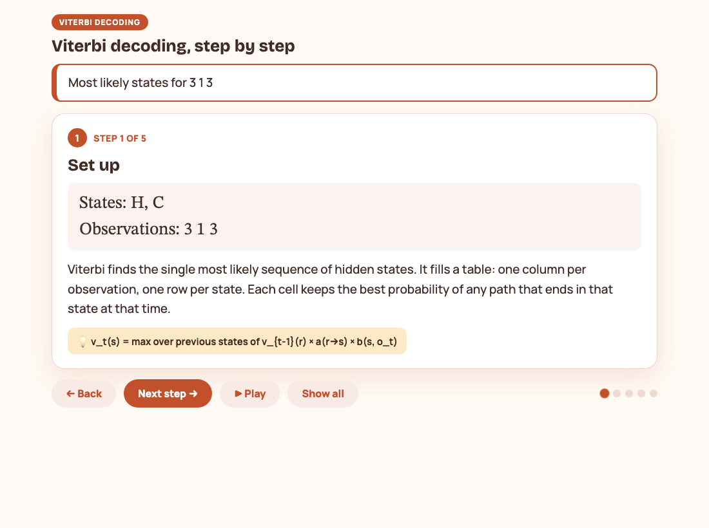{width=85%}

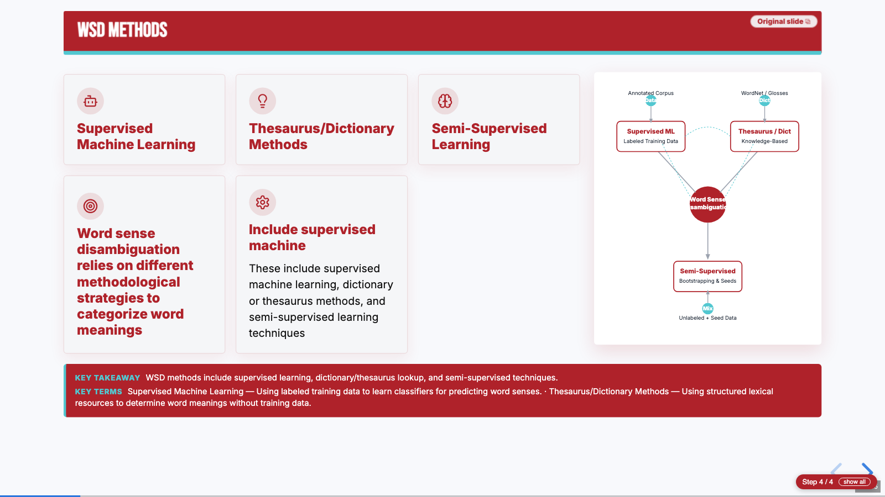{width=95%}

## Testing

The project has 755 automated tests that run in about 25 seconds. They cover each parser, each detector of the decision engine, the layout guarantees (no broken words, no overflow), the quiz rules, every solver, the laboratory policy, the diagram sanitiser, the key pool, the API endpoints and complete end-to-end generation. The tests always run without AI keys: the test configuration blanks every key, so that a key in the developer's environment cannot change the results. In addition, an end-to-end script drives the running API with real files, a layout-audit tool checks finished PowerPoint files, and the gold sets measure the accuracy of the decision engine.

# Results and Evaluation

## Evaluation Setup

We evaluated Learnova on two kinds of material. The **gold sets** are slide texts labelled by hand with the set of acceptable visual families: a development set of 38 slides, a held-out set of 32 slides and a blind set of 31 slides written by a team member who had not seen the rules. The **real decks** are lecture decks from our own courses: two machine-learning PowerPoint files (28 and 63 slides), four slide PDFs (36, 44, 95 and 216 pages) and two Word documents of notes. All timings were measured on a laptop.

## Visual Decision Accuracy

A slide counts as correct when the chosen family is one of the acceptable families, it is drawn as a real visual rather than plain text, and the renderer receives the data it needs.

Table: Visual decision accuracy on the gold sets.

| Gold set | Slides | Strict accuracy | Drawn as a visual | Families used |
|---|---|---|---|---|
| Development | 38 | 97.4% | 100% | 24 |
| Held-out | 32 | 96.9% | 100% | 21 |
| Blind | 31 | 96.8% | 100% | 21 |

Each set had a single miss, in every case a slide for which two families were defensible and the annotator had accepted only one. The median time for a decision was 0.48 milliseconds (95th percentile 0.82 milliseconds), so the engine adds no noticeable time to a deck.

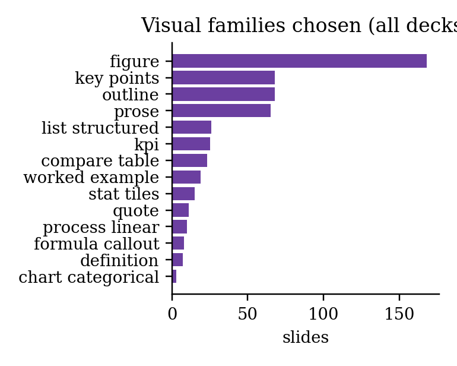{width=70%}

## Fidelity, Layout and Speed

Fact retention is the share of facts in the source — numbers with units, years, percentages and capitalised terms — that also appear in the generated deck:

$$R = \frac{|F_{\text{src}} \cap F_{\text{deck}}|}{|F_{\text{src}}|}.$$

Table: Rebuilt decks without an API key.

| Deck | Source pages | Slides | Time (s) | Fact retention | Slides flagged |
|---|---|---|---|---|---|
| ML: Bias and variance (PPTX) | 28 | 33 | 11.7 | 100% | 6% |
| ML: Linear regression (PPTX) | 63 | 69 | 44.0 | 100% | 7% |
| NLP Module 4 (PDF) | 36 | 47 | 9.8 | 100% | 0% |
| WSD lecture slides (PDF) | 44 | 53 | 14.8 | 98% | 4% |
| NLP Module 5 (PDF) | 95 | 100 | 21.2 | 99% | 3% |
| NLP Syntax analysis (PDF) | 216 | 225 | 34.4 | 100% | 3% |

No slide in any deck was flagged for overflowing text or for a broken word. All flags marked slides that are sparse because their source contained a single short line, which Learnova does not pad with invented content. Run time grows roughly linearly with the length of the deck; PowerPoint files take longer per page because they are converted to PDF first and contain many full-page figures.

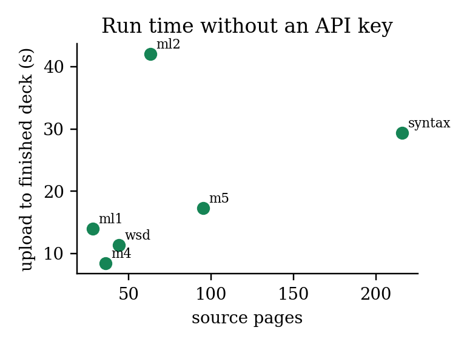{width=65%}

With API keys, the same 36-page deck took about 74 seconds, most of which was spent writing laboratories and diagrams; generating laboratories in parallel reduced this from 163 seconds. When every key was rejected, the deck was still completed in 28 seconds because dead keys are switched off at once.

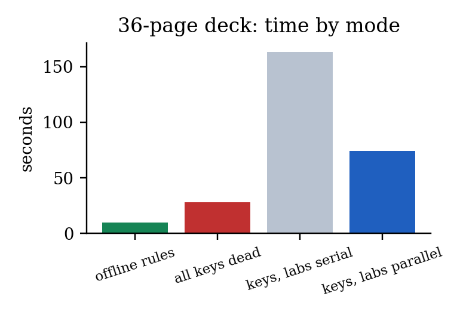{width=60%}

## Before and After

The most direct measure of the project's value is how much each deck changes. The table compares each source deck with the deck Learnova built from it with keys.

Table: Source decks against rebuilt decks.

| Deck | Untitled slides (source) | Slides with a picture (source → rebuilt) | Visual slides | Quizzes | Lab links | Linked illustrations | Fact retention |
|---|---|---|---|---|---|---|---|
| ML: Bias and variance | 14 | 22 → 29 | 22 | 5 | 2 | 12 | 100% |
| ML: Linear regression | 36 | 49 → 64 | 45 | 4 | 8 | 23 | 100% |
| WSD lecture slides | 1 | 7 → 46 | 52 | 7 | 10 | 40 | 98% |
| NLP Module 4 | 0 | 13 → 43 | 43 | 6 | 3 | 37 | 100% |
| NLP Module 5 | 32 | 49 → 96 | 89 | 6 | 13 | 78 | 99% |

Across the five decks, untitled slides fell from 83 to zero; 251 slides were drawn as structured visuals and 190 illustrations were linked to their own pages, while none of the sources had any visual structure, quiz or laboratory. The PowerPoint route made a large difference: on the linear-regression deck the earlier shape-by-shape parser kept only 23 of 63 slides and produced titles such as "Slide 9", whereas the new route kept every slide and showed the original derivations as figures.

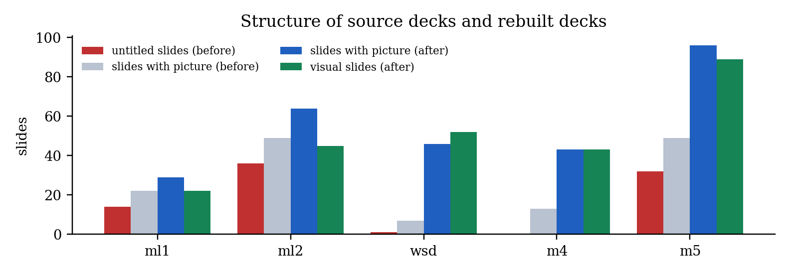{width=100%}

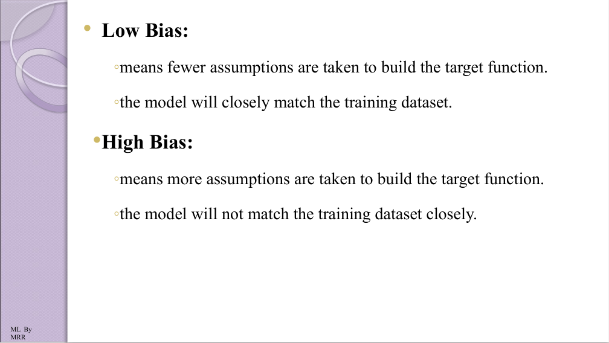{width=70%}

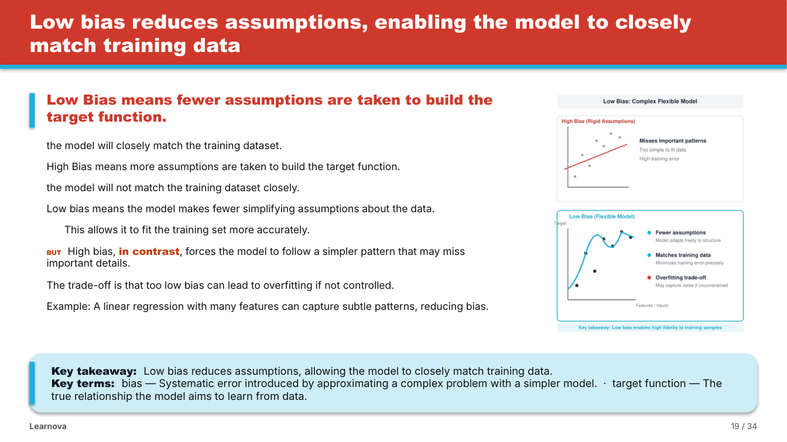{width=80%}

## PSF and CLASS

We computed PSF for each source deck read as it is and for its rebuilt deck. Coherence rose on five of six decks, because every slide gains a real title, a takeaway and a picture next to its text. The mean PSF rose clearly on the two longest decks (from 0.37 to 0.49 and from 0.15 to 0.24) and was unchanged on one, but fell on the two machine-learning decks and the WSD deck. The reason is visible in the components: on those decks the rebuilt slides carry more words, because explanations, examples and key terms are added to thin slides; this raises the estimated load and, because the added sentences repeat concepts already introduced, lowers the information efficiency. In other words, PSF penalises exactly the enrichment we add for readability. This is an honest limitation of a metric built from theory alone, and calibrating its weights against student ratings is part of our future work.

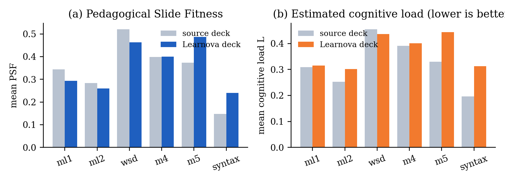{width=100%}

For CLASS, every source slide with more than six points (75 sections) was split with a limit of five points per slide, once with CLASS and once evenly. Both methods used 179 slides in total. CLASS had a lower total cost on 28 sections (37%) and an equal cost on the rest, and it was never worse, as expected of an exact optimiser.

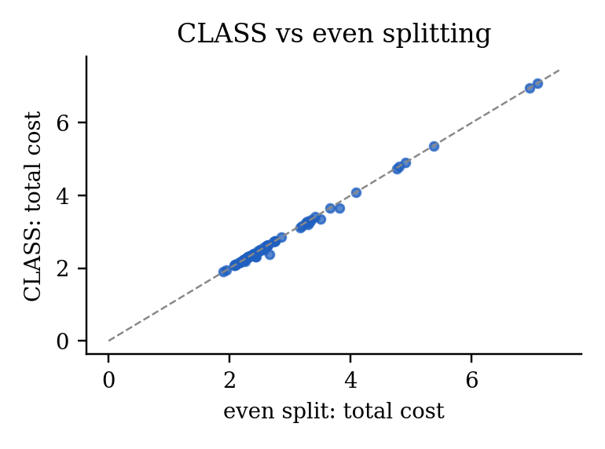{width=60%}

## Step-by-Step Explainers

We wrote 26 problems that do not appear in the tests, with new numbers and new wordings across all solver types, and worked out each answer by hand. The solvers detected 25 of them on the first run; the missed phrasing ("Find x if 4x + 9 = x + 21") was added, after which all 26 were detected, classified and answered correctly, and every step carried a reason. None of 12 ordinary lecture sentences was mistaken for a problem. The median time per problem was 0.7 milliseconds. During this exercise two of our own hand-worked answers turned out to be wrong, and the solvers were right in both cases.

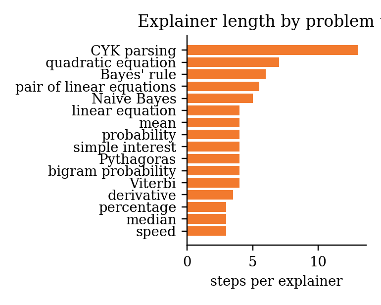{width=65%}

## Illustrations

Without a key, every topic slide receives an offline illustration. With the five-key pool, ten diagrams were written and accepted in 10.1 seconds in parallel. Before we replaced outright rejection with sanitisation, only 71 of 206 model answers (34.5%) passed validation, most of them failing because of inline styles and gradients; after the change all diagrams of a live check were accepted.

# How Learnova Solves the Problem Differently

**It redesigns the deck the teacher already has.** Every existing tool we studied starts from a prompt or a paper and produces a new deck. Learnova starts from the lecture deck itself, so the teacher's structure, wording, examples and figures remain, and the result can be compared slide by slide with the original.

**It is faithful by construction.** Source text is kept verbatim. Text written by a language model is used only after it is checked against the slide's own words, numbers in solved problems are computed rather than generated, and fact retention is measured on every deck. On real decks, 98–100% of the facts were retained.

**It reads real lecture material.** Picture-only slides, symbol-font bullets, titles that lost their spaces, repeated logos, overlapping text boxes and PowerPoint files with untitled slides are all handled by explicit rules. The decision to use OCR is itself a rule with a measurable threshold, so a derivation is never replaced by unreadable text.

**Every slide is visual, and every choice is explained.** The decision engine chooses a visual for every slide with a reason and alternatives, and every topic slide carries an illustration that opens as its own page — a feature none of the compared tools offers.

**It turns reading into practice.** Checkpoint quizzes, exact step-by-step explainers and interactive laboratories follow the research on worked examples and active learning.

**It has its own quality model.** PSF gives a theory-based estimate of how suitable each slide is for learning, and CLASS uses that estimate to split long slides optimally. Both are original contributions of this project.

**It never depends on a paid service.** With free API keys it writes better titles, explanations and diagrams; without them, or when quotas run out, it finishes the deck with its own logic. The whole system runs on a laptop.

**Its layout is guaranteed.** Text is measured glyph by glyph, so nothing overflows and no word is ever split across lines.

# Conclusion and Future Scope

## Conclusion

Learnova shows that the decks teachers already use can be turned into clear, illustrated and interactive lessons automatically without losing what they say. By treating the source content as fixed and making every structural decision with an explicit rule, the system kept 98–100% of the facts of real course decks, removed every untitled slide, chose an appropriate visual for about 97% of slides and never broke a word across lines. Language models are used only where their output can be checked — titles, explanations, diagrams and laboratories — and the system continues to work when every key is exhausted. Two original methods, the PSF metric and the CLASS segmentation algorithm, connect the design of the system to research on cognitive load and multimedia learning. The work has been written up as two research papers, one in IEEE conference format and one in Springer LNCS format.

## Limitations

The decision engine covers the structures we have written detectors for; slides whose meaning lies mainly in a picture still depend on the original figure. OCR of photographed equations is unreliable, which is why such pictures are kept rather than transcribed. Without an API key, slides that are thin in the source remain thin, because the system does not invent content. PSF's weights are taken from the literature and have not yet been calibrated against student judgements, and we have not yet run a controlled study of learning outcomes.

## Future Scope

1. A classroom study with our own batch to measure the effect of the redesigned decks on learning, and calibration of PSF against student ratings.
2. Narrated video export of every deck using text-to-speech and the generated speaker notes.
3. More built-in laboratories for machine learning and image processing topics, and a library where teachers can share their laboratories.
4. A teacher review mode in which each AI suggestion can be accepted or rejected slide by slide.
5. Decks in Hindi and regional languages.
6. Integration with learning management systems such as Moodle and Google Classroom.
7. Deployment as a department service: the front end on a static host and the back end in a container with LibreOffice and Tesseract on a server with persistent storage.

# References {.unnumbered}

1. Y. Hu and X. Wan, "PPSGen: Learning-based presentation slides generation for academic papers," *IEEE Transactions on Knowledge and Data Engineering*, vol. 27, no. 4, pp. 1085–1097, 2015.
2. T.-J. Fu, W. Y. Wang, D. McDuff and Y. Song, "DOC2PPT: Automatic presentation slides generation from scientific documents," in *Proceedings of the AAAI Conference on Artificial Intelligence*, vol. 36, pp. 634–642, 2022.
3. E. Sun, Y. Hou, D. Wang, Y. Zhang and N. X. R. Wang, "D2S: Document-to-slide generation via query-based text summarization," in *Proceedings of NAACL*, pp. 1405–1418, 2021.
4. J. Maynez, S. Narayan, B. Bohnet and R. McDonald, "On faithfulness and factuality in abstractive summarization," in *Proceedings of ACL*, pp. 1906–1919, 2020.
5. Z. Ji et al., "Survey of hallucination in natural language generation," *ACM Computing Surveys*, vol. 55, no. 12, pp. 1–38, 2023.
6. E. Kasneci et al., "ChatGPT for good? On opportunities and challenges of large language models for education," *Learning and Individual Differences*, vol. 103, 102274, 2023.
7. J. Sweller, "Cognitive load during problem solving: Effects on learning," *Cognitive Science*, vol. 12, no. 2, pp. 257–285, 1988.
8. N. Cowan, "The magical number 4 in short-term memory," *Behavioral and Brain Sciences*, vol. 24, no. 1, pp. 87–114, 2001.
9. R. E. Mayer, *Multimedia Learning*, 2nd ed. Cambridge University Press, 2009.
10. M. Alley, M. Schreiber, K. Ramsdell and J. Muffo, "How the design of headlines in presentation slides affects audience retention," *Technical Communication*, vol. 53, no. 2, pp. 225–234, 2006.
11. J. K. Garner and M. P. Alley, "How the design of presentation slides affects audience comprehension: A case for the assertion–evidence approach," *International Journal of Engineering Education*, vol. 29, no. 6, pp. 1564–1579, 2013.
12. E. R. Tufte, *The Cognitive Style of PowerPoint*. Graphics Press, 2003.
13. J. Sweller and G. A. Cooper, "The use of worked examples as a substitute for problem solving in learning algebra," *Cognition and Instruction*, vol. 2, no. 1, pp. 59–89, 1985.
14. R. K. Atkinson, S. J. Derry, A. Renkl and D. Wortham, "Learning from examples: Instructional principles from the worked examples research," *Review of Educational Research*, vol. 70, no. 2, pp. 181–214, 2000.
15. A. Renkl, "Toward an instructionally oriented theory of example-based learning," *Cognitive Science*, vol. 38, no. 1, pp. 1–37, 2014.
16. C. D. Hundhausen, S. A. Douglas and J. T. Stasko, "A meta-study of algorithm visualization effectiveness," *Journal of Visual Languages and Computing*, vol. 13, no. 3, pp. 259–290, 2002.
17. C. E. Wieman, W. K. Adams and K. K. Perkins, "PhET: Simulations that enhance learning," *Science*, vol. 322, no. 5902, pp. 682–683, 2008.
18. M. T. H. Chi and R. Wylie, "The ICAP framework: Linking cognitive engagement to active learning outcomes," *Educational Psychologist*, vol. 49, no. 4, pp. 219–243, 2014.
19. J. Mackinlay, "Automating the design of graphical presentations of relational information," *ACM Transactions on Graphics*, vol. 5, no. 2, pp. 110–141, 1986.
20. D. Moritz et al., "Formalizing visualization design knowledge as constraints: Actionable and extensible models in Draco," *IEEE Transactions on Visualization and Computer Graphics*, vol. 25, no. 1, pp. 438–448, 2019.
21. D. E. Knuth and M. F. Plass, "Breaking paragraphs into lines," *Software: Practice and Experience*, vol. 11, no. 11, pp. 1119–1184, 1981.
22. R. Smith, "An overview of the Tesseract OCR engine," in *Proceedings of ICDAR*, pp. 629–633, 2007.
23. A. Meurer et al., "SymPy: Symbolic computing in Python," *PeerJ Computer Science*, vol. 3, e103, 2017.
24. H. El Hattab, "reveal.js: The HTML presentation framework," https://revealjs.com, accessed October 2026.

# Appendix A: Sample Outputs {.unnumbered}

{width=40%}

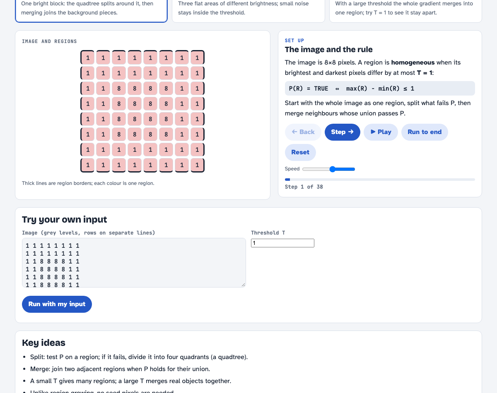{width=85%}

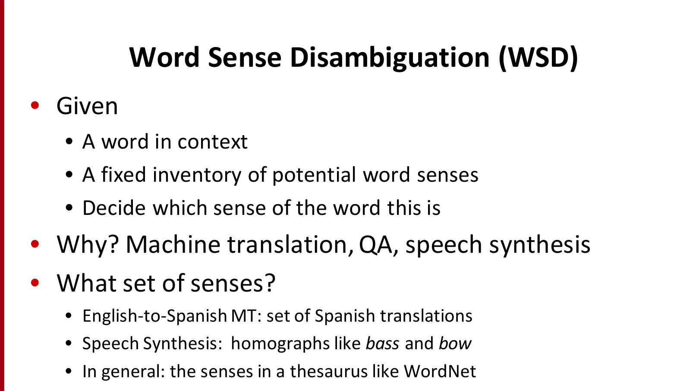{width=70%}

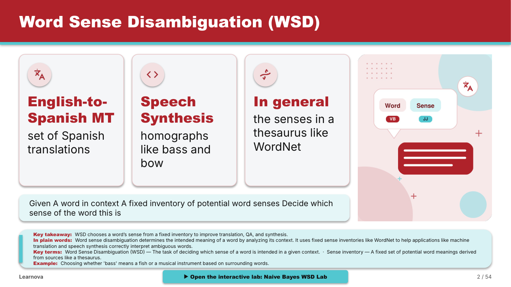{width=80%}

# Appendix B: Project Timeline {.unnumbered}

Table: Project timeline.

| Period | Phase | Main work |
|---|---|---|
| Sep 2025 | Problem selection | Group formation, problem analysis, concept note, plan |
| Oct–Dec 2025 | Research and design | Literature survey, competitor study, requirements, architecture, UI plan |
| Jan–Mar 2026 | Prototype V1 | Parsing, AI rewriting, engagement score, quiz generation, Streamlit demo |
| Apr–Jul 2026 | Learnova V2 | FastAPI and React platform, decision engine, builders, accounts, library, tutor |
| Aug–Oct 2026 | Real decks and research | Slide reader and OCR, illustrations, explainers, laboratories, AI key pool, papers, review |
